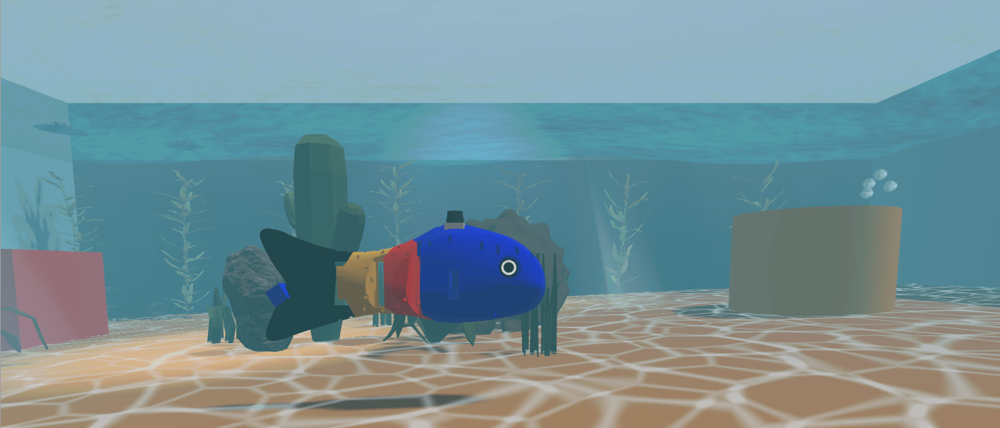
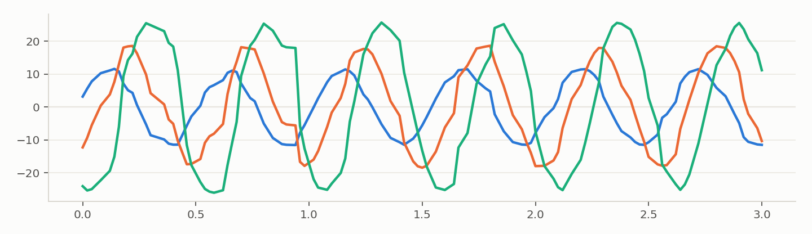
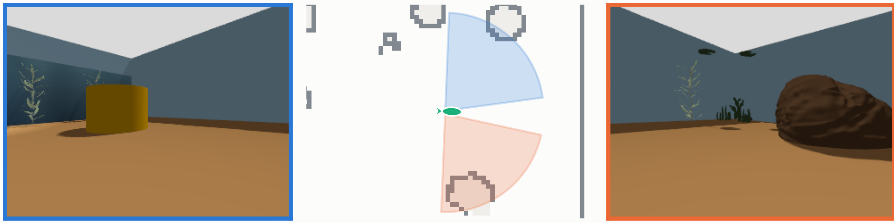
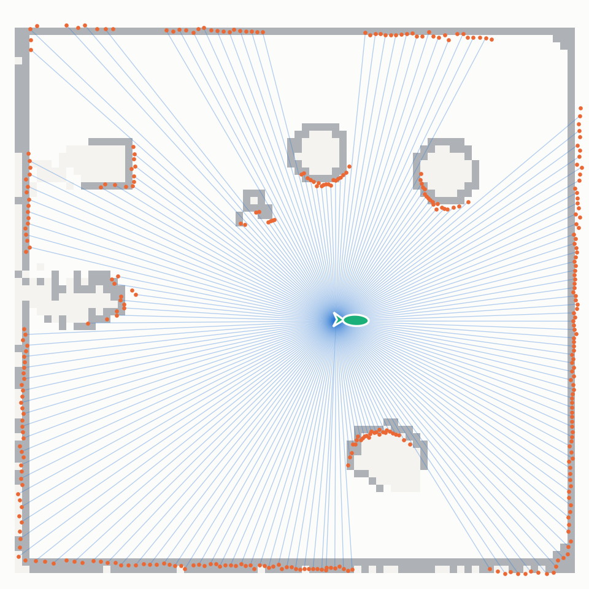
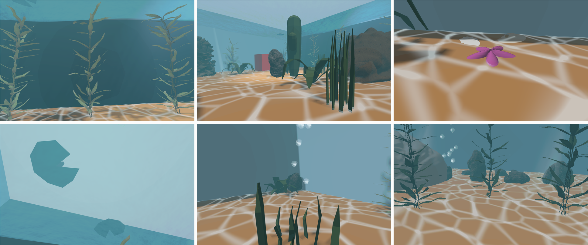
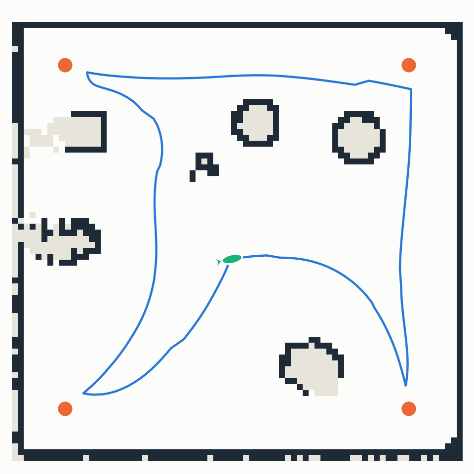
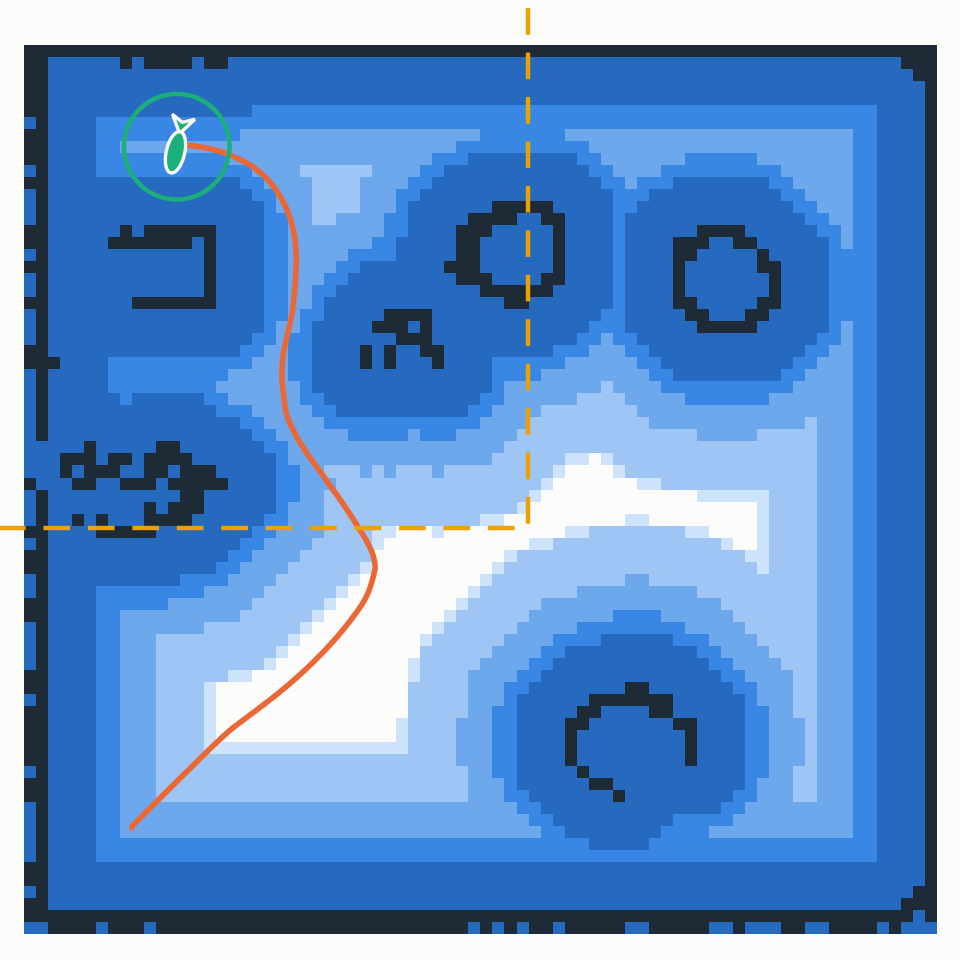
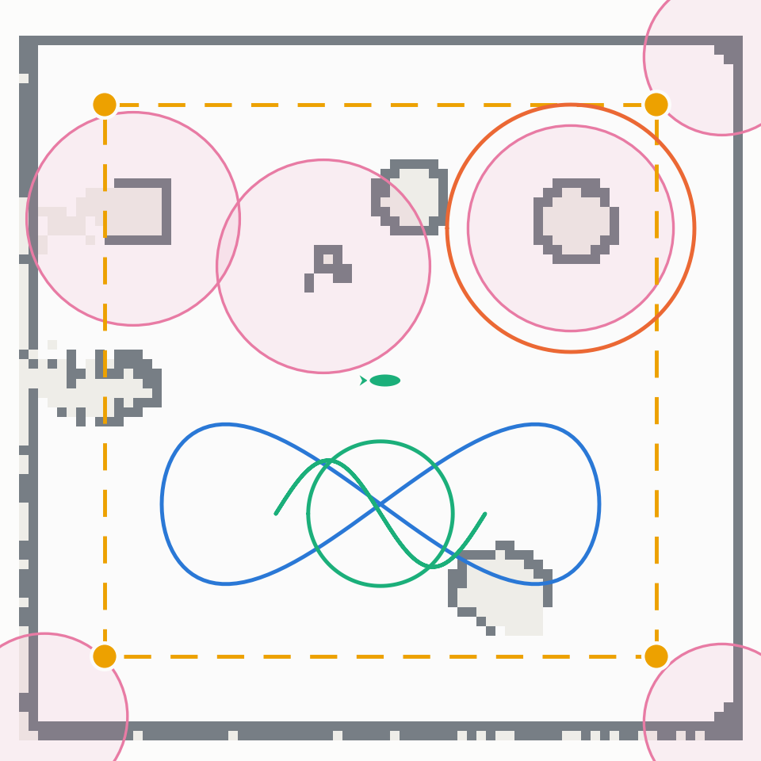

# 🐟 Swishy: A Bio-inspired Robotic Fish with Undulatory Locomotion and Autonomous SLAM-based Navigation using ROS 2



Swishy is a research-oriented simulation platform for studying how body-caudal-fin
(BCF) swimming can be coupled with autonomous robot navigation. A three-joint body
wave drives a fish-shaped robot that maps its aquarium with SLAM, plans with Nav2,
sees through a camera in each eye and swims choreographed missions, all in
ROS 2 Jazzy and Gazebo Harmonic.

**Contents:**
[Quick start](#quick-start) ·
[Manual start](#manual-start) ·
[1. Body](#1-body-a-traveling-body-wave) ·
[2. Senses](#2-senses-fish-eyes-lidar-and-imu) ·
[3. Habitat](#3-habitat-the-aquarium) ·
[4. Mapping](#4-mapping-slam-toolbox) ·
[5. Navigation](#5-navigation-nav2) ·
[6. Missions](#6-missions-showcase-modes) ·
[Repository](#repository) ·
[Git workflow](#git-workflow)

| Capability | How |
|---|---|
| Fish-like swimming | Traveling wave over three tail joints, 1.2 to 2.4 Hz, synced to velocity commands |
| Vision | An invisible camera in each eye, looking out its own side like a real fish |
| Mapping | SLAM Toolbox: 360° LiDAR, scan matching, loop closure, 5 cm occupancy map |
| Localization | SLAM Toolbox localization on the saved map |
| Navigation | Nav2: NavFn global planner, DWB controller, inflated costmaps, collision monitor |
| Missions | Showcase, patrol, dance, explorer and interactive modes, checked against a safety envelope |
| Habitat | Aquascaped tank: rippling water, fog, caustics, bubbles, swaying kelp, rocks, cacti |

## Quick start

Build once (on a fresh machine, `./scripts/setup_workspace.sh --install` installs
the ROS dependencies and builds; `--check` only audits):

```bash
cd ~/swishy
source /opt/ros/jazzy/setup.bash
rosdep install --from-paths src --ignore-src -r -y
colcon build --symlink-install
```

Then start everything with one command. It opens one Terminator window with a pane
per part (Gazebo, SLAM or localization with Nav2 and RViz, the mission, teleop and
both eye-camera viewers); each pane prints the manual command it runs.

```bash
scripts/swishy.sh                          # build a new map (SLAM + Nav2), drive with teleop
scripts/swishy.sh --map --mode patrol      # use the saved map, patrol the four corners
scripts/swishy.sh --map --mode showcase --loop
scripts/swishy.sh --stop                   # stop everything, including a stray Gazebo
```

| Flag | Effect |
|---|---|
| `--slam` (default) / `--map` | Build a new map while navigating / navigate on `maps/` |
| `--mode MODE` | `showcase`, `patrol`, `dance`, `explorer`, `interactive` or `none` (default) |
| `--loop` | Repeat the mission |
| `--no-teleop`, `--no-eyes` | Skip the teleop pane / the eye-camera viewers |

Teleop: click its pane, then use `i` `j` `k` `l` (`,` backwards, `k` stop).
Always stop with `scripts/swishy.sh --stop` (or Ctrl-C in each pane); closing the
window can leave a Gazebo server running, which makes the next run stutter.

## Manual start

The same stack by hand, one terminal each. Source ROS and the workspace in every
terminal first:

```bash
source /opt/ros/jazzy/setup.bash && source ~/swishy/install/setup.bash
```

```bash
# 1. Gazebo: aquarium, Swishy, bridges, gait controller
ros2 launch fishy_fish_navigation spawn_robot.launch.py

# 2a. Build a new map while navigating (SLAM Toolbox mapping + Nav2 + RViz)
ros2 launch fishy_fish_navigation navigation_with_slam.launch.py
# 2b. ...or navigate on the saved map (SLAM Toolbox localization + Nav2 + RViz)
ros2 launch fishy_fish_navigation navigation_with_map.launch.py
#     if the robot is not at the origin, give its pose:
ros2 run fishy_fish_navigation_py send_initialpose --ros-args -p x:=0.0 -p y:=0.0 -p yaw:=0.0

# 3. A mission (once Nav2 is up)
ros2 launch fishy_fish_navigation_py showcase_navigation.launch.py mode:=patrol

# 4. Keyboard driving
ros2 run teleop_twist_keyboard teleop_twist_keyboard

# 5. The eye cameras, one window each
ros2 run rqt_image_view rqt_image_view /left_eye/image
ros2 run rqt_image_view rqt_image_view /right_eye/image
```

Save a map built in 2a (this overwrites the saved map):

```bash
ros2 service call /slam_toolbox/serialize_map slam_toolbox/srv/SerializePoseGraph \
  "{filename: '$HOME/swishy/src/fishy_fish_navigation/maps/serialized'}"
ros2 run nav2_map_server map_saver_cli -f ~/swishy/src/fishy_fish_navigation/maps/map
```

After changing a `.urdf`, launch file or script, rebuild with
`colcon build --symlink-install` and source `install/setup.bash` again.
[src/README.md](src/README.md) documents every node, topic and launch file.

## 1. Body: a traveling body wave


Fish swim by passing a wave of lateral curvature from the body toward the caudal
fin. Swishy approximates this over three tail joints:

$q_i(t)=b_i\kappa(t)+a_iA(s)\sin(\phi(t)-i\Delta\phi)$, with $\dot{\phi}=2\pi f(s)$.

Coefficients $a_i$ grow toward the tail, $\Delta\phi=\pi/3$ makes each joint lag
the one ahead of it, and $\kappa$ bends the body into turns. Like a real fish, the
swing stays large at any swimming speed (at least 60% of the 0.55 rad maximum) and
the tail beats faster to go faster, $f(s)$ from 1.2 to 2.4 Hz
([bio-inspired robotic-fish research](https://doi.org/10.3390/jmse10060773)).



Measured joint angles (degrees) over 3 s of sim time at 0.3 m/s. Blue: joint 1,
nearest the head (±11°); orange: joint 2 (±18°); aqua: joint 3 at the tail (±25°).
Each lags the one before it, so the wave travels head to tail.

A ROS 2 gait controller (`publisher.py`) turns Nav2's velocity commands into these
joint targets at 50 Hz and moves the body in the plane:
$[\dot{x},\dot{y},\dot{\psi}]^T=[v\cos\psi,v\sin\psi,\omega]^T$. Translation goes
through constrained planar joints rather than CFD-resolved tail thrust: a deliberate
abstraction that keeps gait-navigation experiments stable and repeatable, and leaves
a clear path toward hydrodynamic force models and physical validation.

## 2. Senses: fish eyes, LiDAR and IMU



An invisible camera sits in the centre of each eye and looks out its own side,
like a real fish. Left: the left eye's image (blue border). Middle: the map from
above with Swishy facing right and each eye's field of view. Right: the right eye's
image (orange border). Each eye covers 10° to 90° off the heading on its own side,
so together they span 160° with a 20° blind spot straight ahead and no overlap.

| Eye cameras | |
|---|---|
| Mounting | In each eyeball, 4.5 cm behind the body origin, 10 cm up |
| Direction | 50° left / 50° right of straight ahead (40° forward of sideways) |
| Field of view | 80° horizontal each, 320 × 240 px |
| Rate | 5 Hz each (both together render as many frames as one 10 Hz camera) |
| Near clip | 0.1 m, so the camera does not see its own eyeball and head |
| Topics | `/left_eye/image`, `/right_eye/image` (+ `/compressed`), `/<side>_eye/camera_info` |
| Frames | `left_eye_camera_optical`, `right_eye_camera_optical` |

The colour detector (`object_detection_node.py`) and RViz's camera display use the
left eye.



One 360° LiDAR scan (blue rays, orange hits) from the middle of the tank, over the
saved map. The GPU LiDAR has 360 beams, 0.05 to 10 m range and runs at 10 Hz; it
sees the glass, the box, the cylinder and the hard decor, but not the water, kelp or
grass (see [Habitat](#3-habitat-the-aquarium)). An IMU at 50 Hz and the odometry
feed a `robot_localization` EKF.

## 3. Habitat: the aquarium




Inside the tank (left to right, top to bottom): kelp against the painted backdrop;
the cactus centrepiece with its pebble; a starfish and shells by the front glass;
lily pads seen from below; rising bubbles over the grass; kelp and rocks.

**Water** (`models/aquarium_water/`), all visual-only and drawn on the GPU:
a rippling surface from three Gerstner waves, underwater fog, caustics on the sand,
swaying light shafts, rising bubbles and a tinted water volume. Gazebo's renderer
has no fog, so 40 nested shells are re-centred on the camera by a vertex shader.
The shaders use `swishy::WaterShaderParam` (`src/swishy_water`): gz-sim's
`ShaderParam` with depth writes switched off, so transparent effects blend instead
of hiding what is behind them.

**Decor** (`models/`): Fuel kelp swaying in a vertex shader (each plant out of step
with the others), a cactus-and-pebble centrepiece, cacti, rocks and a driftwood log
in the corners, grass and ferns, shells, a starfish, lily pads and a painted
backdrop. The sun and a spot light over the centrepiece cast shadows.

**Sensor-safe by design:**
- Water visuals carry `visibility_flags` 4 and soft decor (kelp, grass, shells,
  starfish, lily pads, backdrop) 8. The LiDAR's mask hides both and the eye cameras
  hide only the water, so `/scan` and the map are unchanged while the cameras still
  see the plants.
- Soft decor has no collision (Swishy can brush through kelp); hard decor (cacti,
  rocks, driftwood) has simple collisions and is mapped.
- Decor colours stay outside the colour detector's HSV ranges.

Change the layout in `scripts/layout_decor.py`, which checks every route and rewrites
the decor block in `fish_world.sdf`. The water meshes come from
`scripts/make_water_grid.py` and `scripts/make_aquarium_effects.py`, the shells,
starfish and backdrop from `scripts/make_decor_assets.py`, and the double-sided
kelp from `scripts/make_kelp_sway_meshes.py`.

## 4. Mapping: SLAM Toolbox



The saved map (`maps/`) with the path Swishy swam on one patrol (blue), the four
patrol stations (orange) and its start pose (aqua). SLAM Toolbox builds a 5 cm
occupancy grid from the LiDAR by scan matching and pose-graph optimization with
loop closure, conceptually
$\mathbf{x}^{*}=\arg\min_{\mathbf{x}}\sum_k\lVert\mathbf{r}_k(\mathbf{x})\rVert_{\Omega_k}^{2}$.
Dark cells are walls and obstacles; the rounded shapes are the box, the cylinder,
the centrepiece and the tank's own rocks and coral.

## 5. Navigation: Nav2



Nav2's global costmap during a patrol leg. Obstacles inflate outward (light to dark
blue as cost rises, dark navy where the robot's centre would collide), the orange
line is NavFn's planned path through the low-cost corridors, the aqua circle is the
robot's 0.22 m footprint and the dashed yellow square is the 3 × 3 m rolling local
costmap the DWB controller drives on.

| Nav2 | |
|---|---|
| Global planner | NavFn on the static map + obstacle layer, 1 Hz |
| Controller | DWB, up to 0.5 m/s and 1.5 rad/s, goal tolerance 0.25 m |
| Costmaps | 5 cm cells, robot radius 0.22 m, inflation 0.70 m |
| Safety | Collision monitor on the LiDAR, active during custom paths |

## 6. Missions: showcase modes



The mission routes over the saved map: the figure-eight (blue), the orbit around the
cylinder (orange), the dance circle and S-curve (aqua) and the patrol square
(dashed yellow). Pink discs are each obstacle's safety envelope (its radius plus
Swishy's 0.22 m radius plus 0.12 m clearance); `navigation_patterns.validate()`
rejects any route point inside one, and `test_navigation_patterns.py` checks every
route against `showcase_profiles.yaml`.

| Mode | What Swishy does |
|---|---|
| `showcase` | Figure-eight, orbit around the cylinder, pauses, back home |
| `patrol` | Visits the four corners, then home |
| `dance` | Double circle, S-curve and a compact figure-eight |
| `explorer` | Random safe goals until stopped (`explorer_goal_count` limits it) |
| `interactive` | Goes to goals from RViz's "2D Goal Pose" (`/goal_pose`) |

```bash
ros2 launch fishy_fish_navigation_py showcase_navigation.launch.py mode:=showcase loop:=true
```

The active path is published on `/swishy/showcase/path` and the state on
`/swishy/showcase/status`. Settings live in
`src/fishy_fish_navigation_py/config/showcase_profiles.yaml`.
Known issue: the orbit passes very close to the tank's own rock at (0.15, 0.95) and
can stall there.

The figures in sections 2, 4, 5 and 6 are rendered from a recorded patrol by
`scripts/make_readme_figures.py` (its header shows how to record the bag).

## Repository

```
swishy/
├── assets/                          README images
├── scripts/
│   ├── swishy.sh                    one-command launcher
│   ├── setup_workspace.sh           dependency check / install + build
│   ├── make_readme_figures.py       renders the technical figures from a bag
│   └── layout_decor.py, make_*.py   aquarium layout and generated assets
└── src/
    ├── fishy_fish_navigation/       robot, world, launch files, configs, maps
    │   ├── urdf/swishy.urdf          body, joints, eye cameras, LiDAR, IMU
    │   ├── urdf/swishy.gazebo        Gazebo plugins and sensors
    │   ├── src/publisher.py          gait controller (body wave + planar motion)
    │   ├── worlds/fish_world.sdf     the aquarium
    │   └── maps/                     saved map (serialized + pgm)
    ├── fishy_fish_navigation_py/    showcase missions, map/pose utilities, tests
    ├── swishy_water/                water shader system plugin
    └── README.md                    detailed node and launch documentation
```

## Git workflow

`feature/*` → PR into `dev` → test → PR `dev` into `main`.

- `main`: stable, only gets `dev` through a PR.
- `dev`: development; every feature merges here first.
- `feature/<name>`: one change, cut from `dev`, deleted after merge.

```bash
# start a feature
git switch dev && git pull
git switch -c feature/<name>

# work, then push
git add <files> && git commit -m "What changed"
git push -u origin feature/<name>
# GitHub: open PR, base = dev, merge it (branch auto-deletes)

# afterwards, clean up locally
git switch dev && git pull && git branch -d feature/<name> && git fetch --prune

# release: when dev works in the sim
# GitHub: open PR, base = main, compare = dev, merge it
git switch main && git pull && git switch dev
```

## Related work

1. [VRX](https://github.com/osrf/vrx/tree/jazzy)
2. [POSIM](https://ioes-lab.github.io/POSIM/)
3. [MBARI vehicles sim (ROS 2)](https://github.com/AlePuglisi/MBARI-vehicles-sim-ros2)
4. [UUV Simulator, ROSCon 2018](https://roscon.ros.org/2018/presentations/ROSCon2018_uuvsimulator.pdf)
5. [Bio-inspired robotic fish, JMSE 10(6):773](https://www.mdpi.com/2077-1312/10/6/773)
6. [Orca4](https://github.com/clydemcqueen/orca4)
7. [Pool simulator for UUV Simulator](https://github.com/cagdasaktay/pool-simulator-uuv_sim)
8. [ASV wave sim](https://github.com/srmainwaring/asv_wave_sim)

## License

Apache License 2.0

## Acknowledgments

Built with ROS 2 Jazzy, Gazebo Harmonic, SLAM Toolbox, Nav2 and robot_localization.

- [VRX](https://github.com/osrf/vrx) (Apache 2.0): Gerstner-wave shaders and
  textures used by the aquarium water, originally from UUV Simulator / Rhys Mainwaring
- [gz-sim](https://github.com/gazebosim/gz-sim) (Apache 2.0): `ShaderParam` system,
  adapted as `swishy::WaterShaderParam` in `src/swishy_water`
- Kelp and Ocean Rock models by Cole Biesemeyer, [Gazebo Fuel](https://fuel.gazebosim.org/1.0/Cole),
  CC-BY 4.0 (rescaled, textures downscaled to 1024², rock texture desaturated)
- Nature models (cacti, mossy rock, driftwood, grass, fern, lily pad) by
  [Quaternius](https://quaternius.com), Ultimate Nature Pack, CC0
