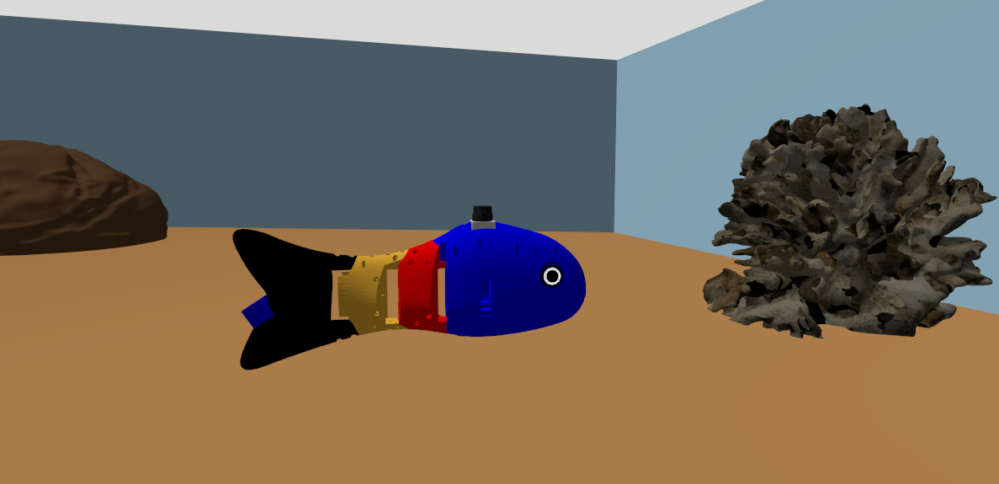
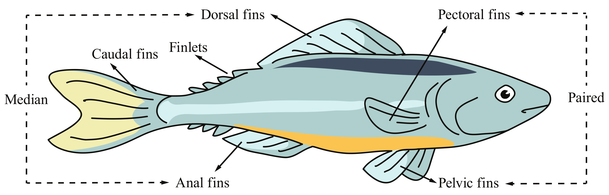
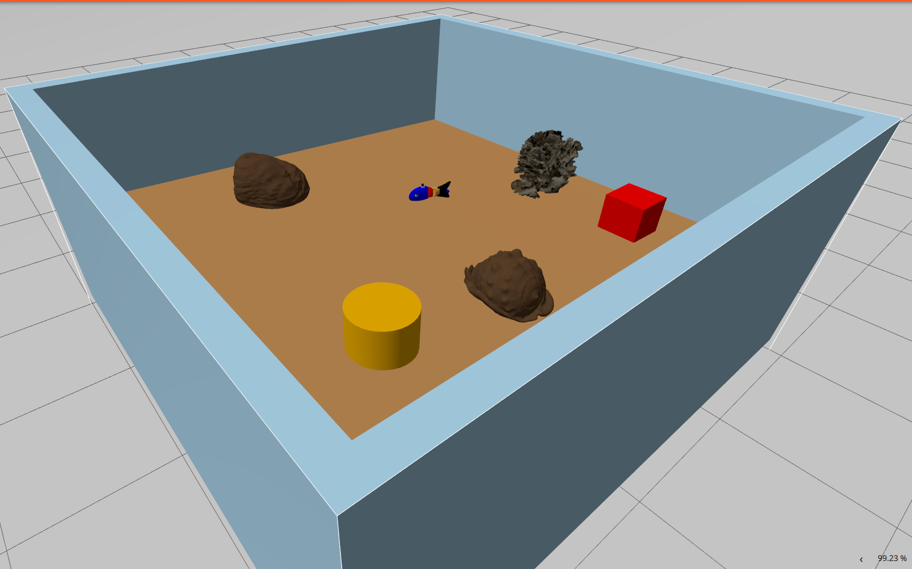
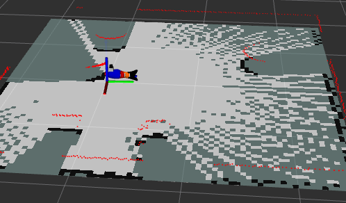
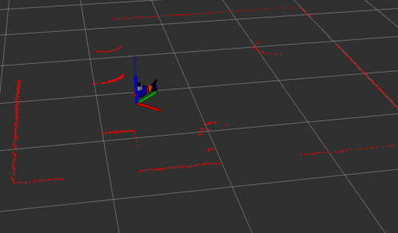
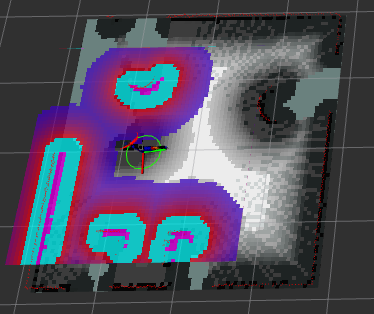
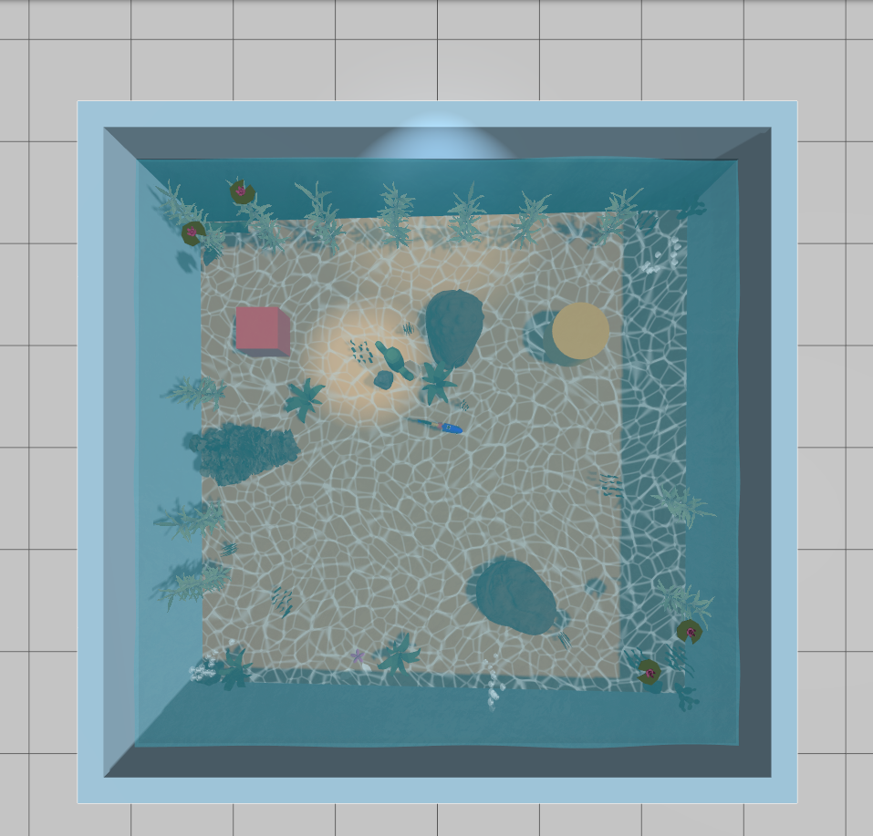
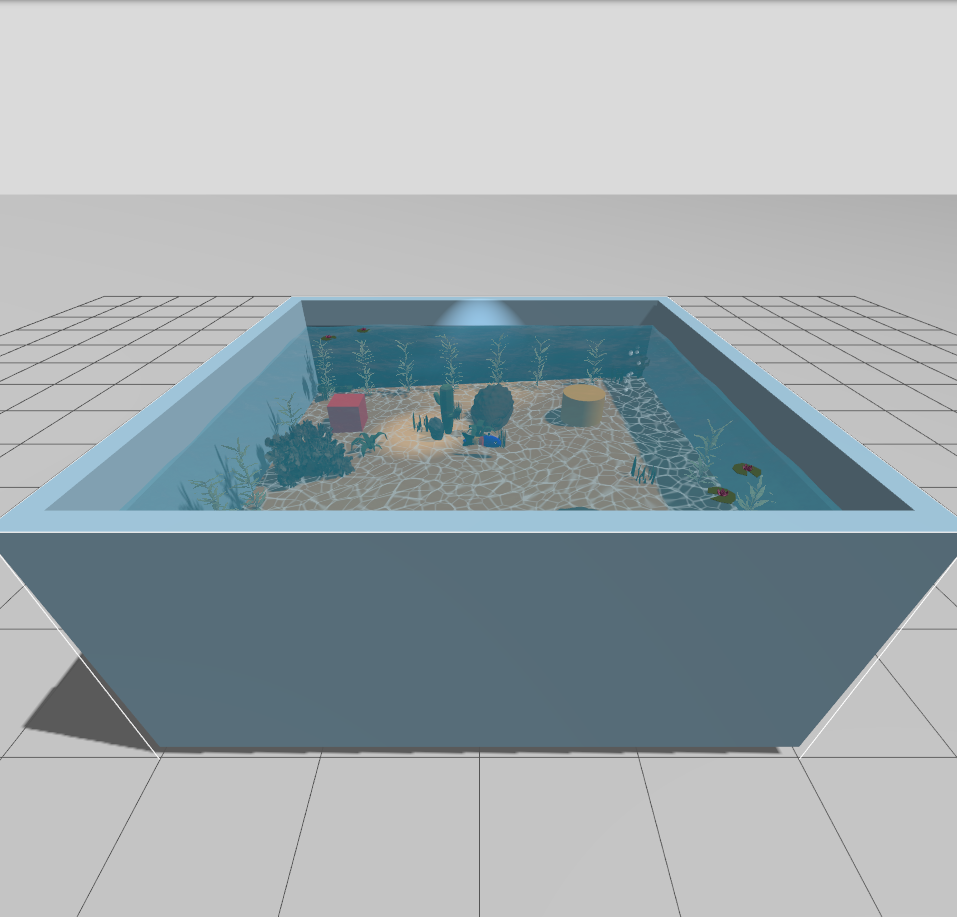
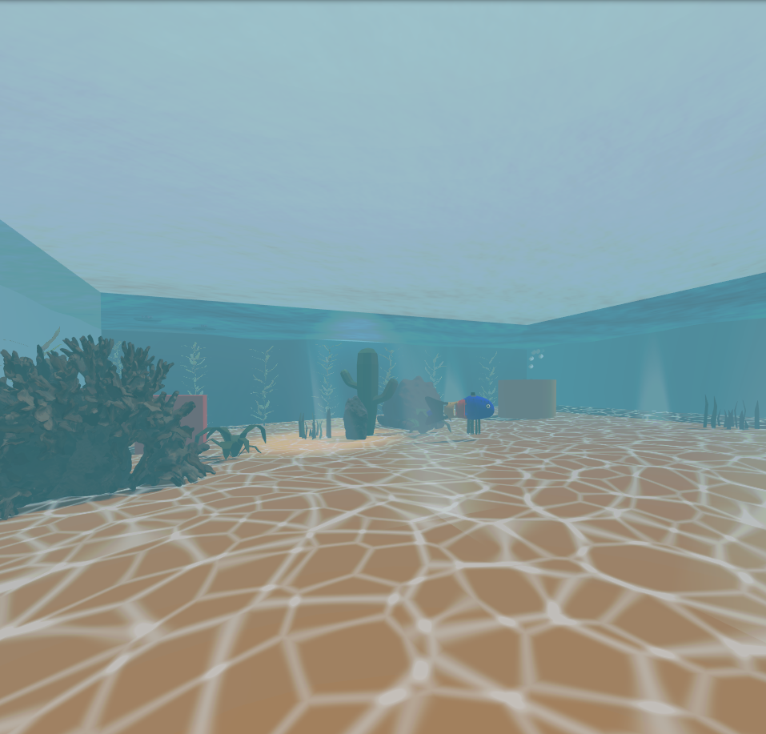

# 🐟 Swishy: A Bio-inspired Robotic Fish with Undulatory Locomotion and Autonomous SLAM-based Navigation using ROS2



**Biological inspiration and motion model.** Swishy is a research-oriented simulation platform for studying how body-caudal-fin (BCF) swimming principles can be coupled with autonomous robotic navigation. Fish generate propulsive and steering motions by passing a w

ave of lateral curvature from the body toward the caudal fin.



 Swishy approximates this behavior across three articulated joints as

$q_i(t)=b_i\kappa(t)+a_iA(s)\sin(\phi(t)-i\Delta\phi)$, with $\dot{\phi}=2\pi f(s)$. 

Here, $A(s)$ and $f(s)$ increase with commanded activity, $\kappa$ introduces a turning bias, and the posteriorly increasing coefficients $a_i$ produce larger motion toward the tail. The implemented gait uses $\Delta\phi=\pi/3$, a maximum tail angle of $0.55$ rad, and a speed-dependent frequency of $1.2$-$2.4$ Hz, following the traveling-wave abstraction widely used in [bio-inspired robotic-fish research](https://doi.org/10.3390/jmse10060773).

**Robotic and simulation implementation.** A custom ROS 2 gait controller converts Nav2 velocity commands into bounded, rate-limited joint trajectories at 50 Hz and rotates body-frame speed into the world frame using:

 $[\dot{x},\dot{y},\dot{\psi}]^T=[v\cos\psi,v\sin\psi,\omega]^T$

The joint wave is executed through `ros2_control` and a forward position controller, while Gazebo Harmonic provides articulated rigid-body dynamics, contact, buoyancy, odometry, and simulated LiDAR, IMU, camera, and NavSat sensing. The current platform deliberately separates visible gait generation from planar propulsion: translation is applied through constrained planar joints rather than being derived from CFD-resolved tail thrust. This controlled abstraction makes gait-navigation experiments stable and repeatable while leaving a clear research path toward hydrodynamic force models, fluid-structure interaction, and physical validation.

**Autonomy and research applications.** A 360-degree LiDAR feeds SLAM Toolbox, where scan matching and loop closure estimate a 5 cm-resolution occupancy map through pose-graph optimization, conceptually:

 $\mathbf{x}^{*}=\arg\min_{\mathbf{x}}\sum_k\lVert\mathbf{r}_k(\mathbf{x})\rVert_{\Omega_k}^{2}$. 

Nav2 then combines NavFn global planning, DWB local trajectory control, layered obstacle/inflation costmaps, and collision monitoring with custom figure-eight, patrol, exploration, dance, and interactive mission modes. 

**Research & Applications.** This implementation project supports research into bio-inspired autonomy, gait-command coupling, confined-space navigation, and sensor-driven behavior, with prospective applications in low-disturbance aquatic monitoring, infrastructure inspection, habitat observation, education, and the development of animal-inspired robots for environments where conventional propellers may be intrusive or difficult to maneuver.

## Overview

This repository contains a complete navigation solution for a fish robot that combines:

- **Biomimetic Motion**: Fish-like undulating motion control
- **SLAM Mapping**: Real-time map building using SLAM Toolbox
- **Localization**: Pose estimation in known environments
- **Autonomous Navigation**: Path planning and obstacle avoidance with Nav2
- **Simulation**: Full Gazebo Harmonic integration

The system is designed for ROS2 Jazzy and uses modern navigation tools to enable autonomous operation of a unique biomimetic robot platform.

## Repository Structure

```
swishy/
├── assets/                    # Result images and screenshots
│   ├── spawn_robot_gazeebo.png
│   ├── mapping.png
│   ├── localization.png
│   └── navigation.png
├── src/                       # ROS2 packages
│   ├── fishy_fish_navigation/      # Main navigation package
│   ├── fishy_fish_navigation_py/  # Python utility package
│   └── README.md                   # Detailed documentation
└── README.md                  # This file
```

## Key Features

- **Biomimetic Motion**: Speed-scaled traveling body wave synchronized with
  planar navigation commands
- **SLAM Mapping**: Real-time map building with loop closure
- **Localization**: Accurate pose estimation using pre-built maps
- **Autonomous Navigation**: Nav2-based path planning and execution
- **Gazebo Simulation**: Full physics simulation with sensors (LiDAR, IMU, Camera)
- **Aquarium Water**: GPU-shaded rippling surface, underwater fog, caustics, light
  shafts and rising bubbles, all visual-only and hidden from the LiDAR and camera
  (see below)
- **Modular Design**: Separate packages for core functionality and utilities

## Quick Start

### Prerequisites

- ROS2 Jazzy
- Gazebo Harmonic
- Required ROS2 packages:
  - `nav2_bringup`
  - `slam_toolbox`
  - `robot_localization`
  - `ros_gz_sim`
  - `ros_gz_bridge`

### Building

For a fresh machine or after ROS packages have been added or upgraded, use the
project bootstrap script:

```bash
cd ~/swishy
./scripts/setup_workspace.sh --install
```

This refreshes apt metadata, upgrades the ABI-coupled ROS 2 control and
middleware packages as one set, installs dependencies declared in
`package.xml` with `rosdep`, and builds the workspace. It intentionally follows
the current ROS 2 Jazzy apt repository versions instead of pinning timestamped
Debian builds, which are removed from the repository over time.

To audit the environment without installing or changing anything:

```bash
./scripts/setup_workspace.sh --check
```

The manual equivalent for routine builds is:

```bash
cd ~/swishy
source /opt/ros/jazzy/setup.bash
rosdep install --from-paths src --ignore-src -r -y
colcon build --symlink-install
source install/setup.bash
```

Source `install/setup.bash` in every new terminal used for this project. This
workspace is an overlay, so sourcing it after the ROS Jazzy underlay (and any
other workspace you intentionally need) makes the fish robot packages take
precedence without changing those installations.

### Running

**0. First time running full flow:**

```bash
# Terminal 1
source /opt/ros/jazzy/setup.bash
source ~/swishy/install/setup.bash
ros2 launch fishy_fish_navigation spawn_robot.launch.py

# Terminal 2
source /opt/ros/jazzy/setup.bash
source ~/swishy/install/setup.bash
ros2 launch fishy_fish_navigation navigation_with_slam.launch.py rviz:=false

ros2 action list | grep follow_waypoints
ros2 run fishy_fish_navigation_py follow_waypoints
```

### Presentation Navigation Modes

Start Gazebo and Nav2 using the first two terminals above. In a third terminal,
launch one presentation mode:

```bash
source /opt/ros/jazzy/setup.bash
source ~/swishy/install/setup.bash

# Smooth figure-eight, obstacle orbit, pauses, and return home
ros2 launch fishy_fish_navigation_py showcase_navigation.launch.py mode:=showcase

# Continuous safe random exploration
ros2 launch fishy_fish_navigation_py showcase_navigation.launch.py mode:=explorer

# Obstacle-aware perimeter patrol
ros2 launch fishy_fish_navigation_py showcase_navigation.launch.py mode:=patrol

# Circles, S-curves, and a compact figure-eight
ros2 launch fishy_fish_navigation_py showcase_navigation.launch.py mode:=dance

# Accept goals from RViz or /detected_object_goal
ros2 launch fishy_fish_navigation_py showcase_navigation.launch.py mode:=interactive
```

Repeat a finite mode until it is stopped:

```bash
ros2 launch fishy_fish_navigation_py showcase_navigation.launch.py \
  mode:=showcase loop:=true
```

The active choreography path is published on `/swishy/showcase/path`, and a
human-readable state is published on `/swishy/showcase/status`. Add a `Path`
display in RViz using the path topic to show the audience where Swishy is
going.

Presentation settings are centralized in
`src/fishy_fish_navigation_py/config/showcase_profiles.yaml`. The configured
safety model includes the approximately 4 x 4 m aquarium interior, Swishy's
radius, wall clearance, the cylinder at `(1.0, 0.8)`, and the box at
`(-1.3, 0.85)`. Nav2 plans obstacle-aware transitions and the collision monitor
remains active while custom curves are followed.

Interactive mode accepts `geometry_msgs/PoseStamped` goals on `/goal_pose`.
It also reserves `/detected_object_goal` for a future perception/localization
node. The current color detector draws camera bounding boxes but does not yet
estimate an object's pose in the map frame.

**1. Spawn Robot in Gazebo:**

```bash
ros2 launch fishy_fish_navigation spawn_robot.launch.py
```

**2. Start Mapping (Optional):**

```bash
ros2 launch fishy_fish_navigation mapping.launch.py
```

**3. Start Navigation with slam:**

```bash
ros2 launch fishy_fish_navigation navigation_with_slam.launch.py
```

**4. Control navigation using teleop:**

```bash
ros2 run teleop_twist_keyboard teleop_twist_keyboard
```

### Running after Modifications

After making changes to the source code like `.urdf` or `.launch.py` files, rebuild the workspace:

```bash
colcon build --packages-select fishy_fish_navigation --symlink-install
source install/setup.bash
ros2 launch fishy_fish_navigation spawn_robot.launch.py
```

For detailed documentation, see [src/README.md](src/README.md).

## Visual Results

### Robot Spawned in Gazebo



The fish robot model spawned in the Gazebo simulation environment with all sensors active (LiDAR, IMU, Camera).

### SLAM Mapping



Real-time SLAM mapping in progress. The robot builds a map of the environment using LiDAR scans while exploring the world.

### Localization



Robot localizing itself in a pre-built map. The pose estimate is shown with uncertainty visualization, allowing the robot to know its position in the known environment.

### Autonomous Navigation



Autonomous navigation in action. Nav2 plans paths to goals while avoiding obstacles, using both global and local costmaps for safe navigation.

### Aquarium Water

The tank is filled with visual-only water from `models/aquarium_water/`:

- **Rippling surface**: three gentle Gerstner waves (wavelengths 1.5 / 0.9 / 0.55 m)
  drawn on the GPU. A flipped copy (`surface_underside`) shows the surface from
  below. Tune `amplitude`, `omega` and `alpha` (opacity) in `model.sdf`.
- **Underwater fog**: Gazebo's renderer has no fog, so 40 nested shells are
  re-centred on the camera by a vertex shader. An object `d` metres away is
  tinted by `1 - exp(-density * d)`; only drawn while the camera is under water.
- **Caustics**: an animated web of refracted light on the sand, drawn on a copy
  of the sand quad lifted 4 mm.
- **Light shafts**: soft, swaying strips from the surface to the sand (underwater only).
- **Bubbles**: three columns of bubbles animated entirely in a vertex shader.
- **Water volume**: a transparent tinted box from the surface (z = 1.6 m) to the sand.
- **Sensor-safe**: every water visual has `visibility_flags` 4. The robot's camera
  uses `visibility_mask` 1073741819 (all bits except 0x4) and the `gpu_lidar`
  1073741811 (also without 0x8, the soft decor below); 0x2 would make the water
  catch clicks in the Gazebo GUI.
  `/scan`, the SLAM map and the color detector don't see the water, so Nav2 and
  SLAM behave exactly as before. There are no collisions, so physics is unchanged.

The shader visuals use `swishy::WaterShaderParam` from the `swishy_water` package:
gz-sim's `ShaderParam` with depth writes switched off. The stock system leaves
depth writes on, so each transparent effect would hide everything behind it.
Sourcing the workspace puts the plugin on `GZ_SIM_SYSTEM_PLUGIN_PATH`.

Regenerate the meshes after changing the tank size with
`python3 scripts/make_water_grid.py [out.obj] [size_x] [size_y] [cells_per_m]` (surface) and
`python3 scripts/make_aquarium_effects.py` (fog shells, light shafts, bubbles, caustics).

### Aquarium Decor







The tank is aquascaped with local models in `src/fishy_fish_navigation/models/`:

- **Kelp** along the back and side glass (Fuel kelp, swaying in a vertex shader;
  each plant gets its own phase from its position, so they never move in sync).
- **Focal point**: a tall cactus with a pebble at (−0.30, 0.60).
- **Corners**: cacti, rocks and a mossy driftwood log.
- **Carpet**: grass and fern patches, shells and a starfish near the front glass,
  lily pads on the surface and a painted blue backdrop on the back glass.
- **Lighting**: sun and a spot light over the focal point cast shadows; the second
  spot over the kelp does not (three shadow casters made the simulation stall on
  integrated graphics).

Sensors and navigation:

- **Soft decor** (kelp, grass, shells, starfish, lily pads, backdrop) has no
  collision and `visibility_flags` 8, so the LiDAR never sees it and Swishy can
  brush through the kelp. The camera still sees it.
- **Hard decor** (cacti, rocks, driftwood) keeps the default flags and simple
  cylinder/box collisions, so it is mapped. Everything at scan height is listed in
  `obstacle_centers`/`obstacle_radii` in `showcase_profiles.yaml`, and
  `test_navigation_patterns.py` checks every showcase route against that list.
- **Colors** stay outside the color detector's HSV ranges: green plants, pink
  starfish, cream shells, desaturated rocks and driftwood. The camera's only
  decor match is a few gray-range pixels on the focal pebble at close range.
- `maps/` was re-mapped with the decor in place.

Change the layout in `scripts/layout_decor.py`, which checks every route and
patrol leg and rewrites the decor block in `fish_world.sdf`. The shells, starfish
and backdrop come from `scripts/make_decor_assets.py`; the double-sided kelp
meshes for the sway shader from `scripts/make_kelp_sway_meshes.py`.

## Documentation

For comprehensive documentation including:

- Detailed node descriptions
- Launch file explanations
- Configuration guides
- Troubleshooting tips
- Complete workflow diagrams

Please refer to [src/README.md](src/README.md).

## Relevant Files:

- `src/fishy_fish_navigation/src/publisher.py`: gait equations, tail-joint wave, steering, speed scaling, and planar kinematics.
- `src/fishy_fish_navigation/urdf/mogi_bot.urdf`: body geometry, articulated links, joints, inertial properties, and limits.
- `src/fishy_fish_navigation/urdf/mogi_bot.gazebo`: planar-motion constraints, Gazebo controllers, odometry, and sensors.
- `src/fishy_fish_navigation/config/fish_control.yaml`: 50 Hz `ros2_control` joint-position controller configuration.

## Additional Repositories

1. [github.com/osrf/vrx/tree/jazzy](https://github.com/osrf/vrx/tree/jazzy)

 2. [ioes-lab.github.io/POSIM](https://ioes-lab.github.io/POSIM/)

3. [github.com/AlePuglisi/MBARI-vehicles-sim-ros2](https://github.com/AlePuglisi/MBARI-vehicles-sim-ros2)

4. [roscon.ros.org/2018/presentations/ROSCon2018_uuvsimulator.pdf](https://roscon.ros.org/2018/presentations/ROSCon2018_uuvsimulator.pdf)

5. [www.mdpi.com/2077-1312/10/6/773](https://www.mdpi.com/2077-1312/10/6/773) 

6. [github.com/clydemcqueen/orca4](https://github.com/clydemcqueen/orca4)

7. [github.com/cagdasaktay/pool-simulator-uuv_sim](https://github.com/cagdasaktay/pool-simulator-uuv_sim)

8. [github.com/AlePuglisi/MBARI-vehicles-sim-ros2](https://github.com/AlePuglisi/MBARI-vehicles-sim-ros2)

9. [github.com/srmainwaring/asv_wave_sim](https://github.com/srmainwaring/asv_wave_sim)

## Packages

### `fishy_fish_navigation`

Main navigation package containing launch files, configurations, robot models, and core nodes.

### `fishy_fish_navigation_py`

Python utility package providing command-line tools for:

- Map loading
- Initial pose setting
- Waypoint navigation

## License

Apache License 2.0

## Acknowledgments

Built with:

- ROS2 Jazzy
- Gazebo Harmonic
- SLAM Toolbox
- Nav2 Navigation Stack
- Robot Localization
- [VRX](https://github.com/osrf/vrx) (Apache 2.0): Gerstner-wave shaders and
  textures used by the aquarium water, originally from UUV Simulator / Rhys Mainwaring
- [gz-sim](https://github.com/gazebosim/gz-sim) (Apache 2.0): `ShaderParam` system,
  adapted as `swishy::WaterShaderParam` in `src/swishy_water`
- Kelp and Ocean Rock models by Cole Biesemeyer, [Gazebo Fuel](https://fuel.gazebosim.org/1.0/Cole),
  CC-BY 4.0 (rescaled, textures downscaled to 1024², rock texture desaturated)
- Nature models (cacti, mossy rock, driftwood, grass, fern, lily pad) by
  [Quaternius](https://quaternius.com), Ultimate Nature Pack, CC0
