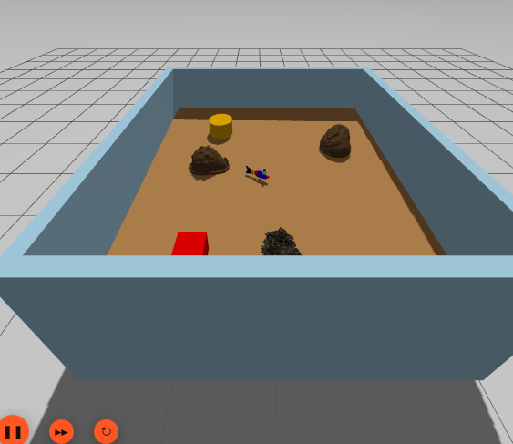

# 🐟 Swishy: A Bio-inspired Robotic Fish with Undulatory Locomotion and Autonomous SLAM-based Navigation using ROS2

A comprehensive ROS2 (Jazzy) navigation stack for a biomimetic fish robot featuring SLAM, localization, and autonomous navigation using Gazebo Harmonic simulation, SLAM Toolbox, and Nav2.

## Overview

This repository contains a complete navigation solution for a fish robot that combines:

- **Biomimetic Motion**: Fish-like undulating motion control
- **SLAM Mapping**: Real-time map building using SLAM Toolbox
- **Localization**: Pose estimation in known environments
- **Autonomous Navigation**: Path planning and obstacle avoidance with Nav2
- **Simulation**: Full Gazebo Harmonic integration

The system is designed for ROS2 Jazzy and uses modern navigation tools to enable autonomous operation of a unique biomimetic robot platform.

## Repository Structure

```
swishy/
├── assets/                    # Result images and screenshots
│   ├── spawn_robot_gazeebo.png
│   ├── mapping.png
│   ├── localization.png
│   └── navigation.png
├── src/                       # ROS2 packages
│   ├── fishy_fish_navigation/      # Main navigation package
│   ├── fishy_fish_navigation_py/  # Python utility package
│   └── README.md                   # Detailed documentation
└── README.md                  # This file
```

## Key Features

- **Biomimetic Motion**: Speed-scaled traveling body wave synchronized with
  planar navigation commands
- **SLAM Mapping**: Real-time map building with loop closure
- **Localization**: Accurate pose estimation using pre-built maps
- **Autonomous Navigation**: Nav2-based path planning and execution
- **Gazebo Simulation**: Full physics simulation with sensors (LiDAR, IMU, Camera)
- **Modular Design**: Separate packages for core functionality and utilities

## Quick Start

### Prerequisites

- ROS2 Jazzy
- Gazebo Harmonic
- Required ROS2 packages:
  - `nav2_bringup`
  - `slam_toolbox`
  - `robot_localization`
  - `ros_gz_sim`
  - `ros_gz_bridge`

### Building

For a fresh machine or after ROS packages have been added or upgraded, use the
project bootstrap script:

```bash
cd ~/swishy
./scripts/setup_workspace.sh --install
```

This refreshes apt metadata, upgrades the ABI-coupled ROS 2 control and
middleware packages as one set, installs dependencies declared in
`package.xml` with `rosdep`, and builds the workspace. It intentionally follows
the current ROS 2 Jazzy apt repository versions instead of pinning timestamped
Debian builds, which are removed from the repository over time.

To audit the environment without installing or changing anything:

```bash
./scripts/setup_workspace.sh --check
```

The manual equivalent for routine builds is:

```bash
cd ~/swishy
source /opt/ros/jazzy/setup.bash
rosdep install --from-paths src --ignore-src -r -y
colcon build --symlink-install
source install/setup.bash
```

Source `install/setup.bash` in every new terminal used for this project. This
workspace is an overlay, so sourcing it after the ROS Jazzy underlay (and any
other workspace you intentionally need) makes the fish robot packages take
precedence without changing those installations.

### Running

**0. First time running full flow:**
```bash
# Terminal 1
source /opt/ros/jazzy/setup.bash
source ~/swishy/install/setup.bash
ros2 launch fishy_fish_navigation spawn_robot.launch.py

# Terminal 2
source /opt/ros/jazzy/setup.bash
source ~/swishy/install/setup.bash
ros2 launch fishy_fish_navigation navigation_with_slam.launch.py rviz:=false

ros2 action list | grep follow_waypoints
ros2 run fishy_fish_navigation_py follow_waypoints
```

### Presentation Navigation Modes

Start Gazebo and Nav2 using the first two terminals above. In a third terminal,
launch one presentation mode:

```bash
source /opt/ros/jazzy/setup.bash
source ~/swishy/install/setup.bash

# Smooth figure-eight, obstacle orbit, pauses, and return home
ros2 launch fishy_fish_navigation_py showcase_navigation.launch.py mode:=showcase

# Continuous safe random exploration
ros2 launch fishy_fish_navigation_py showcase_navigation.launch.py mode:=explorer

# Obstacle-aware perimeter patrol
ros2 launch fishy_fish_navigation_py showcase_navigation.launch.py mode:=patrol

# Circles, S-curves, and a compact figure-eight
ros2 launch fishy_fish_navigation_py showcase_navigation.launch.py mode:=dance

# Accept goals from RViz or /detected_object_goal
ros2 launch fishy_fish_navigation_py showcase_navigation.launch.py mode:=interactive
```

Repeat a finite mode until it is stopped:

```bash
ros2 launch fishy_fish_navigation_py showcase_navigation.launch.py \
  mode:=showcase loop:=true
```

The active choreography path is published on `/swishy/showcase/path`, and a
human-readable state is published on `/swishy/showcase/status`. Add a `Path`
display in RViz using the path topic to show the audience where Swishy is
going.

Presentation settings are centralized in
`src/fishy_fish_navigation_py/config/showcase_profiles.yaml`. The configured
safety model includes the approximately 4 x 4 m aquarium interior, Swishy's
radius, wall clearance, the cylinder at `(1.0, 0.8)`, and the box at
`(-1.3, 0.85)`. Nav2 plans obstacle-aware transitions and the collision monitor
remains active while custom curves are followed.

Interactive mode accepts `geometry_msgs/PoseStamped` goals on `/goal_pose`.
It also reserves `/detected_object_goal` for a future perception/localization
node. The current color detector draws camera bounding boxes but does not yet
estimate an object's pose in the map frame.

**1. Spawn Robot in Gazebo:**
```bash
ros2 launch fishy_fish_navigation spawn_robot.launch.py
```

**2. Start Mapping (Optional):**
```bash
ros2 launch fishy_fish_navigation mapping.launch.py
```

**3. Start Navigation with slam:**
```bash
ros2 launch fishy_fish_navigation navigation_with_slam.launch.py
```

**4. Control navigation using teleop:**
```bash
ros2 run teleop_twist_keyboard teleop_twist_keyboard
```

### Running after Modifications
After making changes to the source code like `.urdf` or `.launch.py` files, rebuild the workspace:
```bash
colcon build --packages-select fishy_fish_navigation --symlink-install
source install/setup.bash
ros2 launch fishy_fish_navigation spawn_robot.launch.py
```

For detailed documentation, see [src/README.md](src/README.md).

## Visual Results

### Robot Spawned in Gazebo



The fish robot model spawned in the Gazebo simulation environment with all sensors active (LiDAR, IMU, Camera).

### SLAM Mapping


Real-time SLAM mapping in progress. The robot builds a map of the environment using LiDAR scans while exploring the world.

### Localization


Robot localizing itself in a pre-built map. The pose estimate is shown with uncertainty visualization, allowing the robot to know its position in the known environment.

### Autonomous Navigation


Autonomous navigation in action. Nav2 plans paths to goals while avoiding obstacles, using both global and local costmaps for safe navigation.

## Documentation

For comprehensive documentation including:
- Detailed node descriptions
- Launch file explanations
- Configuration guides
- Troubleshooting tips
- Complete workflow diagrams

Please refer to [src/README.md](src/README.md).

## Packages

### `fishy_fish_navigation`
Main navigation package containing launch files, configurations, robot models, and core nodes.

### `fishy_fish_navigation_py`
Python utility package providing command-line tools for:
- Map loading
- Initial pose setting
- Waypoint navigation

## License

Apache License 2.0

## Acknowledgments

Built with:
- ROS2 Jazzy
- Gazebo Harmonic
- SLAM Toolbox
- Nav2 Navigation Stack
- Robot Localization

